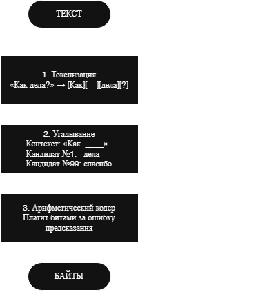
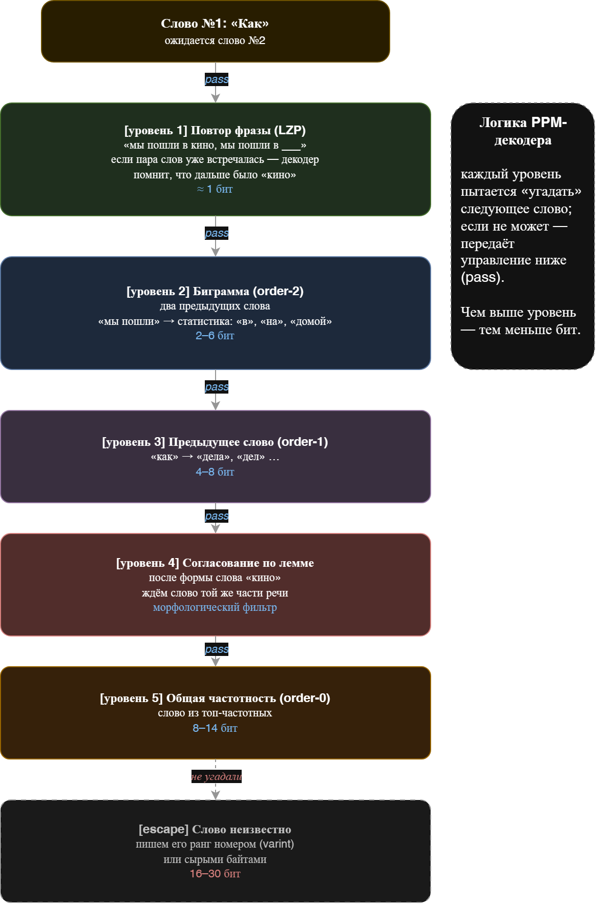
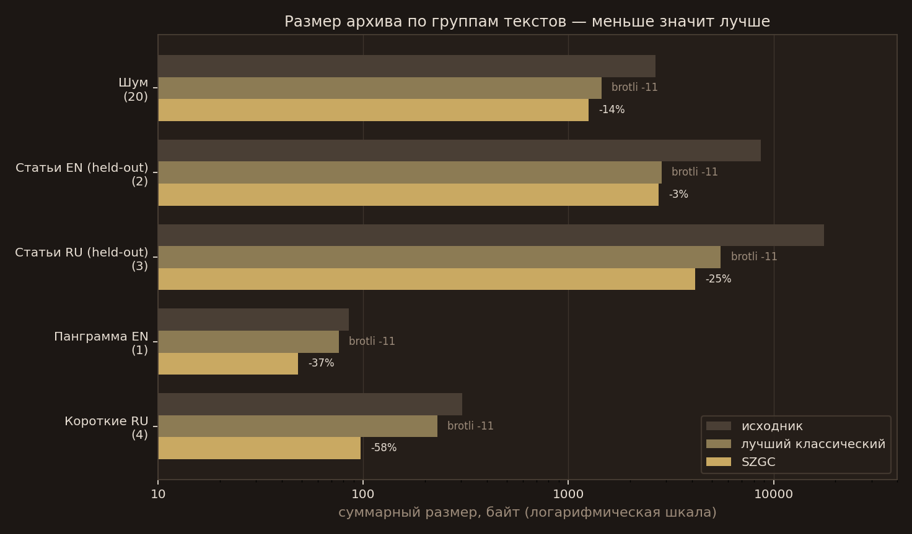
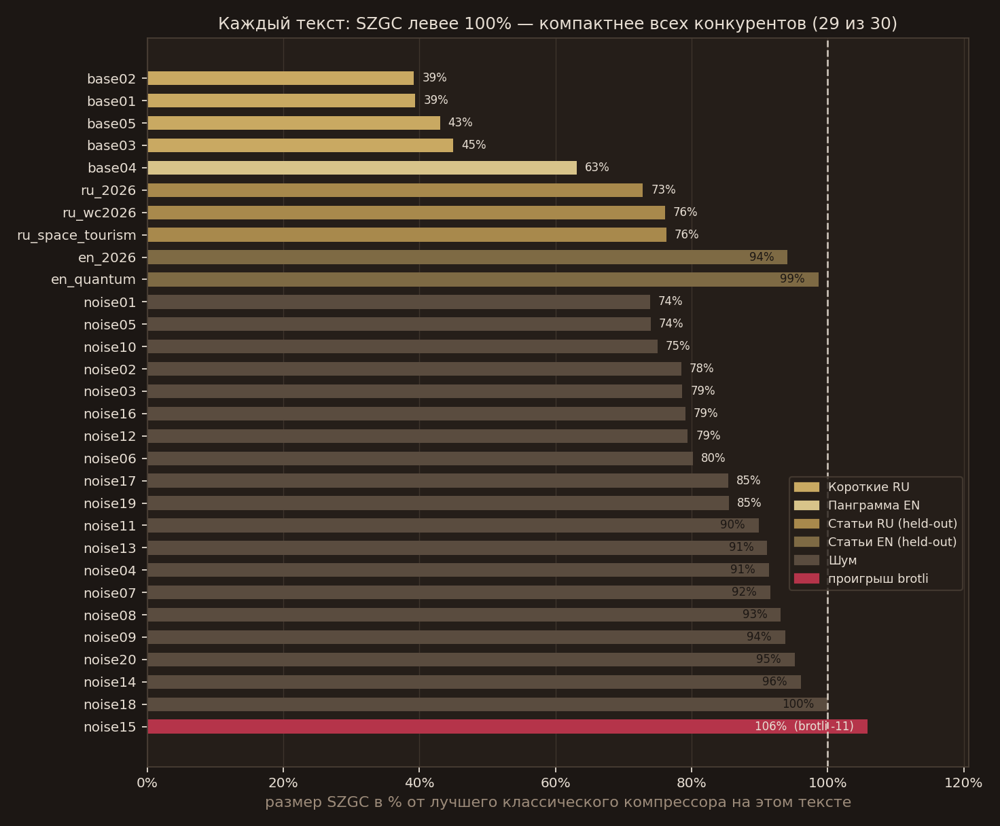

<div align="center">


&nbsp;&nbsp;


# SyllaZip

**SZGC** (SyllaZip Graph Coder) — формат и библиотека сжатия текстов для коротких
сообщений: чатов, заголовков, push-уведомлений, SMS.

<p>

  
  
  
  
  <a href="https://deblinux-dev.github.io/SyllaZip/"></a>
  
  

</p>
<p>
  <a href="#результаты-измерений"></a>
  <a href="BENCHMARK.md"></a>
  <a href="#детерминизм-почему-это-важно"></a>
  <a href="#обучение-в-google-colab"></a>
</p>

[Демо](https://deblinux-dev.github.io/SyllaZip) ·
[Бенчмарк](BENCHMARK.md) ·
[Спецификация](SPEC.md) ·
[Обучение в Colab](#обучение-в-google-colab) ·
[Релизы](https://github.com/deblinux-dev/Syllazip/releases)

</div>

На ультракоротких русских текстах он сжимает в **2,2–2,6 раза плотнее**, чем brotli — один из лучших компрессоров современности, — и выигрывает у gzip, bzip2, xz, brotli и zstd на **29 из 30** тестовых текстов: от 13-байтовых сообщений до 8-килобайтных статей, на обоих языках. Единственный непокорённый текст — 13-байтовая строка из трёх эмодзи, где 17–18 байт занимает сам контейнер, а не сжатие ([подробнее](#результаты-измерений)).

При этом SZGC не использует нейросети и работает одинаково на любом процессоре: побайтово тот же результат на Intel, ARM, в браузере и в телефоне.

```
«Привет! Как дела?»         30 Б  ->  13 Б   (brotli: 33)
«Сегодня мы пошли в кино…»  87 Б  ->  27 Б   (brotli: 60)
Статья Википедии, 5,9 КБ  5 945 Б -> 1 443 Б (brotli: 2 013)
Статья Википедии EN, 5,6 КБ 5 574 Б -> 1 716 Б (brotli: 1 740)
```

## Что дальше (TODO)

- [x] **Модель для английского.** Готово: контекстное взвешивание O0 (SplitO0), аддитивные EN-пары в B2/B1 и корпус 2,85 ГБ с EN-половиной. EN-статьи теперь тоже выигрывают у brotli: `en_quantum` −24 Б, `en_2026` −65 Б; русский без регрессии (см. [результаты](#результаты-измерений)).
- [x] **Обновить бенчмарк и тесты после обучения.** Готово: тот же набор из 30 текстов, эталонные векторы `tests/vectors.json` перегенерированы, кросс-проверки py/JS/Rust зелёные.
- [ ] **Версии моделей и языков.** Дать нескольким моделям (RU, EN и следующим) работать вместе без раздувания заголовка архива и без потери обратной совместимости: либо определять версию и язык вероятностно по структуре графа (тест энтропии, перебор кандидатов), либо подмешивать в поток магическое число, либо использовать свободные биты в теге (запас на 64 модели).
- [ ] **Ускорить кодирование.** Кэш сумм строк и ленивое обновление таблиц.

## Содержание

1. [Идея за 60 секунд](#идея-за-60-секунд)
2. [Почему обычные архиваторы плохо сжимают короткие тексты](#почему-обычные-архиваторы-плохо-сжимают-короткие-тексты)
3. [Как работает SZGC: пошагово](#как-работает-szgc-пошагово)
4. [Арифметическое кодирование](#арифметическое-кодирование)
5. [Чем SyllaZip отличается от классического PPM](#чем-syllazip-отличается-от-классического-ppm)
6. [Страховка: байтовые режимы](#страховка-байтовые-режимы)
7. [Результаты измерений](#результаты-измерений)
8. [Детерминизм: почему это важно](#детерминизм-почему-это-важно)
9. [Реализации и сборка](#реализации-и-сборка)
10. [Использование](#использование)
11. [Обучение в Google Colab](#обучение-в-google-colab)
12. [Практическое использование и FAQ](#практическое-использование-и-faq)
---

## Идея за 60 секунд

Представьте игру: я пишу начало фразы, а вы продолжаете.

- «Не забудь купить …» — вы почти наверняка сказали «хлеб» или «молоко».
- «Сегодня мы пошли в …» — вы ждёте «кино», «театр», «школу».

Человеческий язык избыточен: по началу фразы часто можно угадать продолжение. **Компрессор платит битами только за неожиданность.** Если следующий символ предсказан точно — он стоит доли бита. Если не угадал — приходится платить полной монетой: 8 и больше бит на байт.

SZGC делает ровно это. Внутри него — заранее обученная «модель языка»: огромный словарь словоформ русского и английского (600 000 форм) плюс статистика «что обычно идёт после чего». Кодер идёт по тексту, на каждом шаге спрашивает модель «что, по-твоему, будет дальше?» и упаковывает ответ арифметическим кодером — так, что угаданное почти ничего не стоит.

<div align="center">
<br>

<br>
</div>

Распаковка симметрична: декодер несёт ту же модель и тем же способом
«угадывает», поэтому ему не нужна таблица слов в каждом сообщении —
он просто восстанавливает текст из потока битов.

---

## Почему обычные архиваторы плохо сжимают короткие тексты

Классические компрессоры (gzip, zstd, brotli) устроены как конструктор: они ищут повторяющиеся куски внутри **самого сообщения**. Пока сообщение короткое, повторяться нечему — и почти весь выигрыш съедают служебные данные, которые компрессор кладёт в начало файла (оверхед).

Разложим на части сообщение «Привет! Как дела?» (30 байт):

| Компрессор | Служебное | Полезное сжатие | Итого |
|---|---|---:|---:|
| gzip -9    | ~30 байт заголовков | почти ноль (повторов нет) | 53 |
| zstd -19   | ~18 байт заголовков | почти ноль | 39 |
| brotli -11 | встроенный словарик помогает чуть-чуть | — | 33 |
| **SZGC**   | **0 байт** — словарь уже в декодере | слова найдены в модели | **13** |

Главный трюк SZGC: **весь «служебный» словарь вынесен из сообщения и
зашит в программу**. Декодер заранее знает 600 000 словоформ, поэтому в
сжатом потоке слово «привет» — это просто «ранг № такой-то», упакованный
за 1–2 бита, а не 6–7 байт текста.

---

## Как работает SZGC: пошагово

### Шаг 1. Токенизация

Текст режется на три вида кусков:

- **слово** — буквы подряд (русские и латинские): `Привет`, `дела`, `ох`;
- **пунктуация** — 48 заранее известных знаков и их сочетаний с пробелами
  (`.`, `, `, `. `, `! `, ` — ` и т. д.);
- **литерал** — всё остальное: числа, эмодзи, иероглифы, неизвестные слова.

### Шаг 2. Словарь словоформ

Словарь обучен заранее на большом корпусе (2,85 ГБ: Википедия RU/EN,
OpenSubtitles RU/EN, проза Taiga, новостные и технические корпуса OPUS). Каждая словоформа — отдельный ранг:

```
ранг 0      ->  "you"      (самая частая)
ранг 15     ->  "is"
ранг 213    ->  "этом"
ранг 599999 ->  "размещенному"
```

Важно: в словаре лежат именно **словоформы** («пошли», «пошла», «пошёл» — три разные формы, 12 612 из них с буквой «ё»), а не абстрактные леммы. Частотные формы получают маленький ранг и потому почти ничего не стоят. Подход с леммами, как выяснилось, не даёт существенного выигрыша в сжатии и чаще лишь «раздувает» данные из-за избыточности комбинаций.

### Шаг 3. «Угадывание»: пять уровней контекста

Для каждого слова SZGC пробует уровни предсказания — от самого точного к самому общему: повтор фразы (LZP) → биграмма двух предыдущих слов → «слово после слова» → контекст пунктуации → лемматическое согласование. Если уровень не знает ответ, он говорит «pass» (escape), и его символы **исключаются** из нижних уровней, чтобы не платить дважды.

<div align="center">
<br>

<br>
</div>

Пунктуация и регистр тоже предсказываются: после точки вероятнее заглавная буква, после «ЦБ» вероятнее верхний регистр у второй буквы.

### Шаг 4. Неизвестное

Если слова нет в словаре (имя, опечатка, ссылка), SZGC переключается на сырые байты — но и тут каждый байт предсказывается контекстом предыдущих байтов (order-1…3). Два варианта («словарная цепочка» или «сырые байты») просчитываются **оба**, и записывается только тот, что короче.

---

## Арифметическое кодирование

Это самая «математическая» часть, но идея простая. Представьте числовую
ось от 0 до 1. Каждый возможный символ занимает на ней отрезок: чем он
вероятнее — тем длиннее отрезок.

```
модель говорит: после "Как" с вероятностью 3/8 будет "дела",
                2/8 — "спасибо", 3/8 — всё остальное

0                     3/8          5/8                       1
|-------- "дела" ------|--- "спасибо" -------|---- прочее ---------|
```

Кодер читает текст и «нарезает» ось по этим долям, выбирая каждый раз
отрезок очередного символа. В конце остаётся крошечный интервал — любое
число из него однозначно описывает весь текст. Осталось записать это
число двоичными цифрами:

- символ с вероятностью 1/8 стоит log₂8 = 3 бита;
- «неожиданный» символ с вероятностью 1/1000 стоит ≈ 10 бит;
- если модель угадала точно (вероятность близка к 1) — цена стремится к нулю.

**Итог: чем лучше модель угадывает, тем короче поток.** Компрессия — это
чистая функция качества предсказания. SZGC тратит свои силы именно на
предсказание, а не на поиск повторов.

Технически используется range-кодер в стиле LZMA: только целочисленная
арифметика 32/64 бита, никаких дробей с плавающей точкой — поэтому любой
процессор получает побайтово одинаковый результат (так гарантируется детерминированность).

---

## Чем SyllaZip отличается от классического PPM?

SZGC принадлежит к семейству PPM (Prediction by Partial Matching —
предсказание по частичному совпадению) и развивает идею PPMd — одного из
сильнейших текстовых компрессоров. Но есть принципиальные отличия:

| | Классический PPM / PPMd | SZGC |
|---|---|---|
| Алфавит | отдельные **байты** (256 символов) | **слова, знаки и литералы** — единицы языка |
| Модель | собирается **из самого сообщения**, с нуля | предобучена на корпусе и зашита в кодек |
| Короткие тексты | слабо: модели не на чем учиться | сильно: словарь уже есть, 0 байт служебных |
| Единица предсказания | следующий **байт** | следующее **слово** (по двум предыдущим, по лемме, по повтору фразы) |
| Знание языка | нет | словоформы, леммы, согласование, регистр |
| Смешивание порядков | детерминированный escape-каскад | тот же каскад + целочисленный выбор «словарь ↔ сырые байты» на каждый токен |
| Скорость | сотни КБ/с | 8 КБ/с (Python), 15 КБ/с (JS), 35 КБ/с (Rust) — медленнее всех |
| Детерминизм | зависит от реализации | гарантирован: только целые числа, фиксированный порядок перечисления |

> [!TIP]
> PPM начинает жизнь в каждом сообщении заново и потому хорош лишь на длинных текстах. Архив SZGC «рождается» с уже заложенной энтропией — словарём и статистикой языка — и потому выигрывает именно там, где PPM и словарные LZ-компрессоры бессильны: на сообщениях длиной с SMS.

---

## Страховка: байтовые режимы

Что, если текст — вообще не язык? Случайный шум, бинарный мусор, Base64?
На этот случай каждый вызов `compress` кодирует текст **двумя способами**:

1. **токенный** — со словарём и угадыванием (описан выше);
2. **чисто байтовый** — адаптивный контекстный кодер без словаря (цепочки контекстов длиной 3, 2 и 0 байтов, всё подбирается на лету).

В поток пишется меньший из вариантов, первый байт потока (тег) говорит декодеру, какой режим использовать. Стоимость — 0 бит: тег это просто первый байт.

```
[тег 0x02..0x05][range-кодированные данные]

0x02 — токенный режим (словарь + контексты слов)
0x03 — байтовый: контексты o3+o2+o0
0x04 — байтовый: o2+o0
0x05 — байтовый: только адаптивный order-0
```

Благодаря этой страховке SZGC на любом входе ведёт себя не хуже адаптивного
контекстного кодера — и почти не «раздувается» на неподходящих данных.

---

## Результаты измерений

Полная таблица и построчные данные — в [BENCHMARK.md](BENCHMARK.md).
Набор текстов лежит в репозитории, поэтому итог нельзя посчитать по меньшему
числу строк: `bench.py` падает, если хоть один текст отсутствует.

| Группа | n | Исходник | **SZGC** | gzip 9 | bzip2 9 | xz 9e | brotli 11 | zstd 19 | Побед |
|---|---:|---:|---:|---:|---:|---:|---:|---:|---:|
| Короткие RU (чат, новость, ЦБ) | 4 | 303 | **97** | 329 | 338 | 496 | 230 | 273 | 4 из 4 |
| Английская панграмма | 1 | 85 | **48** | 93 | 108 | 144 | 76 | 82 | 1 из 1 |
| Новостные статьи RU | 3 | 17 647 | **4 145** | 6 722 | 5 611 | 6 496 | 5 603 | 6 514 | 3 из 3 |
| Новостные статьи EN | 2 | 8 660 | **2 751** | 4 043 | 3 995 | 4 196 | 2 840 | 3 973 | 2 из 2 |
| Псевдослучайный шум | 20 | 2 654 | **1 251** | 1 942 | 1 922 | 2 924 | 1 497 | 1 731 | 19 из 20 |
| **Итого** | **30** | **29 349** | **8 292** | 13 129 | 11 974 | 14 256 | 10 246 | 12 573 | **29 из 30** |

Единственное исключение:

| Текст | SZGC | brotli 11 | Разница | Почему |
|---|---:|---:|---:|---|
| `noise15` (13 Б) | 18 | 17 | +1 Б | три эмодзи: 17–18 байт — это размер контейнера, а не качество модели |

Против остальных четырёх конкурентов счёт чистый: **30 из 30** — SZGC меньше gzip, bzip2, xz и zstd на каждом тексте; против brotli — 29 из 30. По сумме всех 30 текстов SZGC (8 292 Б) компактнее brotli (10 246 Б) на 19 %. На семи русских текстах суммарно **4 242 Б против 5 833 Б** у brotli (на 27 % компактнее), на трёх английских — **2 799 Б против 2 916 Б** (−4 %). EN закрыт контекстным взвешиванием O0 (SplitO0 — язык предыдущего слова задаёт вес символа), аддитивными EN-парами в B2/B1 и корпусом 2,85 ГБ (см. `docs/lang-round2.md`).

Воспроизведение:

```bash
pip install brotli zstandard
python bench.py 
```



*Группа текстов — три полосы: исходник, лучший классический компрессор и SZGC.
Логарифмическая шкала: иначе 30-байтовые сообщения рядом со статьями не видны.
Процент — насколько SZGC меньше или больше лучшего классического архиватора в
этой группе; единственный «плюс» — у английских статей.*



*Каждая полоса — SZGC в процентах от лучшего классического компрессора на этом
тексте. Левее 100 % — SZGC компактнее; красные полосы — три исключения: две
английские статьи и 13-байтовый шум, где SZGC проиграл brotli один байт.
Цвет полосы — группа текста.*

## Детерминизм: почему это важно

Большинство «умных» и нейросетевых компрессоров используют арифметику с плавающей точкой,
хэш-таблицы с непредсказуемым порядком или обучение в несколько потоков.
Из-за этого сжатый файл на телефоне ARM и на сервере x86 может отличаться
вплоть до невозможности распаковать.

SZGC спроектирован так, что это исключено:

- **только целочисленная арифметика** — range-кодер в стиле LZMA, счётчики
  частот, все сравнения стоимости (в том числе выбор «словарь или сырые
  байты») — через длины целых чисел в битах, без единого `float`;
- **фиксированный порядок перечисления** таблиц и символов;
- **снимок состояния** — каждый вызов `compress`/`decompress` стартует с чистого
  состояния модели (адаптация откатывается);
- **кросс-проверка реализаций**: Python, JavaScript и Rust дают побайтово
  одинаковые потоки (31 эталонный вектор + 150 текстов в обе стороны).

Следствие: сообщение, сжатое в браузере, гарантированно распакуется на сервере, и наоборот. Это делает формат пригодным для чатов, мессенджеров и офлайн-приложений.

---

## Реализации и сборка

Единый формат — три реализации. Модель (`graph-model.bin`) одна и та же: `python bench.py` показывает, что все три дают одинаковые байты.

```
syllazip/
├── szgc_core.py        # ядро Python
├── szgc_codec.py       # Python-кодек + selftest
├── szgc_cli.py         # Python CLI
├── build_model.py      # офлайн-тренер
├── graph-model.bin     # модель
│   ├── index.html      # веб-демо
│   ├── demo.html       # минималистичное демо
│   ├── model/          # копия graph-model.bin для самостоятельного запуска web/
│   ├── szgc.js         # браузерный порт (UMD: браузер + Node)
│   ├── js/             # контроллеры интерфейса
│   └── css/            # дизайн-система «academia» (махагон + латунь)
├── rust/               # реализация на Rust + CLI (бинарник szgc)
├── assets/             # логотипы, схемы, бейджи
├── docs/               # графики бенчмарка
├── tests/              # векторы, фаззеры, тексты бенчмарка
├── tests/holdout/      # 5 отложенных статей Википедии + их ревизии
├── bench.py            # бенчмарк: 30 текстов, без пропусков
├── scripts/            # частотные словари
├── train_colab.ipynb   # обучение своей модели в Google Colab
├── SPEC.md             # спецификация формата
├── BENCHMARK.md        # полный бенчмарк
└── .github/workflows/  # ci.yml (тесты + релизы), pages.yml (демо на GitHub Pages)
```

Требования: Python 3.10+ (только стандартная библиотека, для обучения — `pymorphy3` и `numpy`), Node 18+, Rust 1.70+.

### Rust

```bash
cd rust
cargo build --release
./target/release/szgc selftest 500     # векторы + round-trip + фаззинг
```

Сборка требует только компилятор Rust; внешних зависимостей нет. Модель встраивается в бинарник на этапе компиляции — готовый файл (~19 МБ) полностью автономен и не требует файлов рядом.

### Python

Ничего устанавливать не нужно (только стандартная библиотека):

```bash
python szgc_cli.py c input.txt out.szgc
python szgc_cli.py d out.szgc restored.txt
```

### JavaScript (браузер и Node)

```js
const SZGC = require("./web/szgc.js");            // window.SZGC в браузере
const resp = await fetch("web/model/graph-model.bin");
SZGC.loadModel(new Uint8Array(await resp.arrayBuffer()));
const blob = SZGC.compress("Привет! Как дела?");  // Uint8Array
const text = SZGC.decompress(blob);               // string
```

### Браузер

Демо работает полностью локально: модель загружается один раз, сжатие и распаковка идут офлайн, результат побайтово совпадает с Python и Rust.

```bash
python3 -m http.server 8000
# http://localhost:8000/web/index.html
```

Онлайн-версия публикуется на GitHub Pages —
[https://deblinux-dev.github.io/SyllaZip/](https://deblinux-dev.github.io/SyllaZip/)

### Готовые бинарники (GitHub Actions)

[`.github/workflows/ci.yml`](.github/workflows/ci.yml)

| Платформа | Файл |
|---|---|
| Linux x86_64 | `szgc-linux-x86_64.tar.gz` |
| Linux ARM64 | `szgc-linux-aarch64.tar.gz` |
| macOS Intel | `szgc-macos-x86_64.zip` |
| macOS Apple Silicon | `szgc-macos-aarch64.zip` |
| Windows x86_64 | `szgc-windows-x86_64.zip` |

Каждый архив содержит статический бинарник `szgc` со встроенной моделью — скачал и работаешь без установки чего-либо.

**Releases**: [https://deblinux-dev.github.io/SyllaZip/releases](https://deblinux-dev.github.io/SyllaZip/releases)

---

## Использование

### Python

```python
import szgc_codec as S

blob = S.compress("Привет! Как дела?")   # bytes, тег + range-поток
text = S.decompress(blob)                # исходная строка
```

### Rust CLI

```bash
szgc c input.txt output.szgc             # сжать файл
szgc d output.szgc restored.txt          # распаковать
szgc t "Привет! Как дела?"               # сжать строку, hex в stdout
szgc bench                               # мини-бенчмарк на встроенных текстах
szgc selftest 500                        # векторы + round-trip + фаззинг
szgc model-info                          # статистика модели
szgc batch texts.json > hexes.json       # пакетное сжатие (JSON-массив строк)
szgc batchdec hexes.json                 # пакетная распаковка
```

По умолчанию используется модель, встроенная в бинарник; флаг `--model PATH` позволяет подложить свою (обученную в Colab) модель.

### Скорость

Замеры на одной машине (2 ядра), один и тот же текст, медиана нескольких прогонов. Для сравнения — brotli и gzip на тех же данных; у них нет загрузки модели, поэтому их время уходит только на само сжатие (без прогрева).

| Текст | Размер | Python | JS (Node) | Rust | brotli -q11 | gzip -9 |
|---|---:|---:|---:|---:|---:|---:|
| «Привет! Как дела?» | 30 Б | 4,7 мс | 1,9 мс | 0,9 мс | 0,2 мс | 0,01 мс |
| «Не забудь купить хлеб и молоко.» | 56 Б | 9,7 мс | 3,4 мс | 0,9 мс | 0,2 мс | 0,01 мс |
| Статья «Космический туризм» | 4,0 КБ | 545 мс | 287 мс | 148 мс | 6,4 мс | 0,17 мс |
| Статья «2026 год» | 5,9 КБ | 735 мс | 407 мс | 171 мс | 9,3 мс | 0,24 мс |

Распаковка быстрее сжатия в 10–20 раз: сообщение в 56 байт — 0,2 мс (Python, JS)
и 0,5 мс (Rust), статья в 6 КБ — 43 мс (Python), 20 мс (JS), 25 мс (Rust).
Загрузка модели: 2,9 с (Python), 1,2 с (Node), 0,5 с (Rust), в браузере — один
сетевой запрос на 17,9 МБ, дальше в памяти.

**Это самое слабое место SyllaZip.** На статье в
6 КБ SZGC в 20 раз медленнее brotli и в тысячи раз медленнее gzip.
Этому есть вполне обоснованные причины:

- на каждый токен считается несколько десятков бит арифметического кодирования,
  и перед каждым выбором пересобираются суммы строк таблиц;
- каскад таблиц (слово → пара слов → лемма → пунктуация) — это ветвления,
  которые процессор не может предсказать, а зависимости между шагами не дают
  распараллелить поток;
- в Python и JS это ещё и интерпретация: Rust быстрее в 4 раза, но не на
  порядок — упирается алгоритм, а не язык.

Ситуацию спасает то, что в первую очередь цели — ультракороткие и средние тексты. 30–60 байт сжимаются
за 1 мс в Rust и 5–10 мс в Python, распаковка — быстрее миллисекунды. 

**TODO**: Для ускорения, в принципе, можно использовать кэш префиксных сумм, ленивое обновление таблиц, отказ от пересчёта каскада там, где верхняя таблица уже дала точный прогноз. 

---

## Обучение в Google Colab

Модель можно обучить заново — на своём языке, своём стиле или своём корпусе.
Для этого в репозитории лежит ноутбук [`train_colab.ipynb`](train_colab.ipynb): он сам скачивает корпуса, обучает модель, проверяет её и отдаёт готовый `graph-model.bin`.

### Что делает ноутбук

| Шаг | Клетка | Что происходит |
|---|---|---|
| 0 | зависимости | `pip install pymorphy3 numpy requests brotli zstandard` |
| 1 | корпуса | OPUS (новости, GlobalVoices, KDE4, Ubuntu), OpenSubtitles RU+EN, Википедия RU+EN, проза Taiga, частотные списки RU/EN |
| 2 | тренер | записывает `szgc_core.py` и `build_model.py` и переводит их пути в `/content` |
| 3 | обучение | 4 стадии: униграммы → словарь и леммы → контексты → упаковка SZGM |
| 4 | верификация | round-trip, детерминизм, таблица против gzip/bz2/xz/brotli/zstd |
| 5 | выгрузка | `graph-model.bin` и `model-stats.json` скачиваются в браузер |

### Как запустить

1. Откройте `train_colab.ipynb` в [Google Colab](https://colab.research.google.com/)
   (File → Upload notebook).
2. Среда выполнения: **CPU достаточно** — обучение на `numpy` и `pickle`, GPU не
   используется и не ускоряет его.
3. Запустите клетки по порядку. Скачивание корпусов и обучение идут долго,
   поэтому клетки 1–3 можно перезапускать по отдельности: стадии общаются через
   `/content/stage/*.pkl`.
4. В конце ноутбук скачает модель — это и есть ваш `graph-model.bin`.

Время и место целиком зависят от того, сколько корпуса вы возьмёте: ноутбук печатает объём скачанного и время каждой стадии, ориентируйтесь на его вывод. Свободное место нужно под сырые корпуса и промежуточные `*.pkl` — смело планируйте десятки гигабайт, если поднимаете `PREFIX_B` и `cap`.

### Ручки масштаба

Все параметры — константы в начале `build_model.py`:

| Параметр | По умолчанию | Зачем |
|---|---:|---|
| `PREFIX_B` (ноутбук) | 300 МБ | сколько сжатого текста качать из OpenSubtitles на язык |
| `cap` (ноутбук) | 300 МБ | сколько брать из Википедии на язык |
| `TOTAL_CAP` | 3 ГБ | предел корпуса, дальше файлы пропускаются |
| `DICT_CAP` | 600 000 | размер словаря словоформ |
| `O0_TOP` | 131 072 | сколько символов моделировать в order-0 |
| `CTX_B1_ROWS`, `B2_ROWS` | 65 536 (+16 384/+32 768 EN сверх топа) | число строк контекстов «слово→слово» и биграмм |
| `LEM_ROWS` | 16 384 | число лемматических контекстов |
| `B1_KEEP`, `B2_KEEP`, `LEM_KEEP`, `A_KEEP`, `C_KEEP` | 14, 9, 12, 4, 8 | сколько символов держать в каждой строке контекста |
| `B1_MIN_CNT`, `B2_MIN_CNT`, `LEM_MIN_CNT`, `A_MIN_CNT` | 40, 20, 30, 40 | порог частоты, ниже которого пара выбрасывается |

Практические советы:

- **уменьшаете модель** — режьте `DICT_CAP`, `O0_TOP`, `CTX_B1_ROWS`: размер
  файла растёт линейно, а выигрыш от хвоста словаря быстро падает;
- **свой язык** — замените корпуса в клетке 1 и частотные списки в
  `scripts/ru_50k.txt`, `scripts/en_50k.txt`; латинский алфавит модель уже знает;
- **свой стиль** (например, переписка) — дайте больше субтитров и меньше Википедии: стиль корпуса задаёт распределение рангов;
- **не трогайте** `B*_KEEP` без переобучения: они влияют на количество символов в строках и на размер модели.

### Обучение без Colab

Тот же тренер запускается локально. Понадобятся `pymorphy3`, `numpy` и корпус в
`data/corpus/*.txt`:

```bash
pip install pymorphy3 numpy
SZGC_BASE=$PWD python build_model.py          # все 4 стадии
SZGC_BASE=$PWD python build_model.py stage2   # или отдельная стадия
```

Результат: `download/syllazip/graph-model.bin` и `model-stats.json`.

### Как подключить новую модель

| Куда | Что сделать |
|---|---|
| Python | положить `graph-model.bin` рядом с `szgc_core.py` (путь берётся из расположения модуля) |
| Rust | `szgc c in.txt out.szgc --model my-graph-model.bin` — или скопировать файл в корень репозитория и пересобрать, чтобы вшить его в бинарник |
| Браузер | заменить `web/model/graph-model.bin` |

### Что проверять после обучения

1. `python szgc_codec.py` — round-trip и детерминизм на новом файле.
2. `node tests/szgc_crosscheck.js` — если векторы разошлись, изменился формат
   (а не только веса): обновите `tests/vectors.json` осознанно, иначе старые
   архивы перестанут читаться.
3. `python bench.py` — сравните с таблицей выше: больше корпуса ≠ всегда меньше
   байт, иногда лишний стиль размывает ранги частотных слов.

---

## Практическое использование и FAQ

### **В каких сферах может использоваться SyllaZip?**

Прежде всего, алгоритм был задуман после того, как автор столкнулся с задачей сжатия коротких текстов и предложений, решений для которой практически не было (все известные алгоритмы либо добавляли большой оверхед сжатия и не имели достаточной эффективности, либо вовсе требовали переписывания своих алгоритмов). В результате сфера применения алгоритма может быть следующей:    
  
- передача текстовых данных в Air-Gapped средах через каналы с низкой пропускной способностью;
- хранение и передача коротких текстов: чаты, мессенджеры, портативные устройства обмена сообщениями;
- _КНЕЯ_ (Команды На Естественных Языках);
- стеганография и смежные с ней области, где важна экономия каждого бита.

**Q: SZGC заменяет gzip и прочие алгоритмы сжатия для файлов?**
Нет. SZGC — текстовый кодек. Он не задумывался и не предназначен для сжатия бинарных данных (аудио, приложения, видео, изображения и т.п. — для них есть более эффективные методы сжатия). Для больших файлов правильнее использовать zstd/xz/bzip2: они быстрее и дешевле по памяти.
Ниша SZGC — короткие и средние тексты, где классика теряет всё на
служебных данных.

**А если текст на другом языке?**
Модель обучена на русском и английском. Текст на другом языке тоже сожмётся и распакуется (байтовые режимы-страховки не подведут), но выигрыш будет как у обычного адаптивного кодера. Решение — обучить модель на своём корпусе через [`train_colab.ipynb`](#обучение-в-google-colab).

**Q: Почему не нейросеть?**
Нейросети предсказывают точнее, но требуют гигабайтов памяти (ROM, RAM, VRAM), медленны без GPU и, главное, **недетерминированны** между устройствами: разные порядки суммирования с плавающей точкой дают разные биты.

**Как быстро работает?**
См. таблицу [«Скорость»](#скорость): 8 КБ/с (Python), 15 КБ/с (JS), 35 КБ/с
(Rust). На сообщении в 30–60 байт это 1–10 мс, на статье в 6 КБ — до 0,7 с.
Старт (разбор модели) дороже самого сжатия, поэтому в сервисе модель грузят
один раз и держат в памяти.

**Сохраняются ли регистр и буква «ё»?**
Да, полностью: словарь — это набор словоформ с регистровыми флагами, `ё` отдельная буква (12 612 словоформ в модели). `decompress` возвращает ровно тот текст, который был на входе, — «Всё ещё ёлка» останется «Всё ещё ёлка».

**Что будет с битым файлом или не тем форматом?**
Декодер проверяет тег первого байта и границы потока и возвращает ошибку, а не мусор в stdout: `szgc d` завершится с ненулевым кодом.

---

## Лицензия

MIT — см. [LICENSE](LICENSE). Модель `graph-model.bin` распространяется на тех же условиях как часть проекта.

Корпуса, на которых обучена модель (Википедия, OpenSubtitles, Taiga, OPUS), имеют собственные лицензии; в репозитории лежит только производная статистическая модель, а не исходные тексты.
